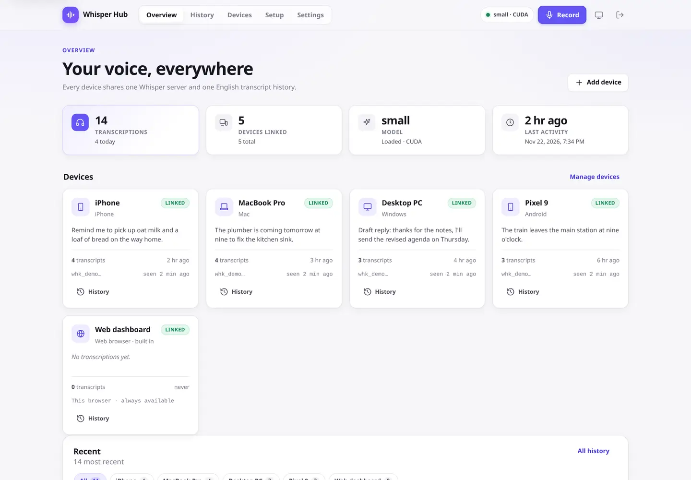
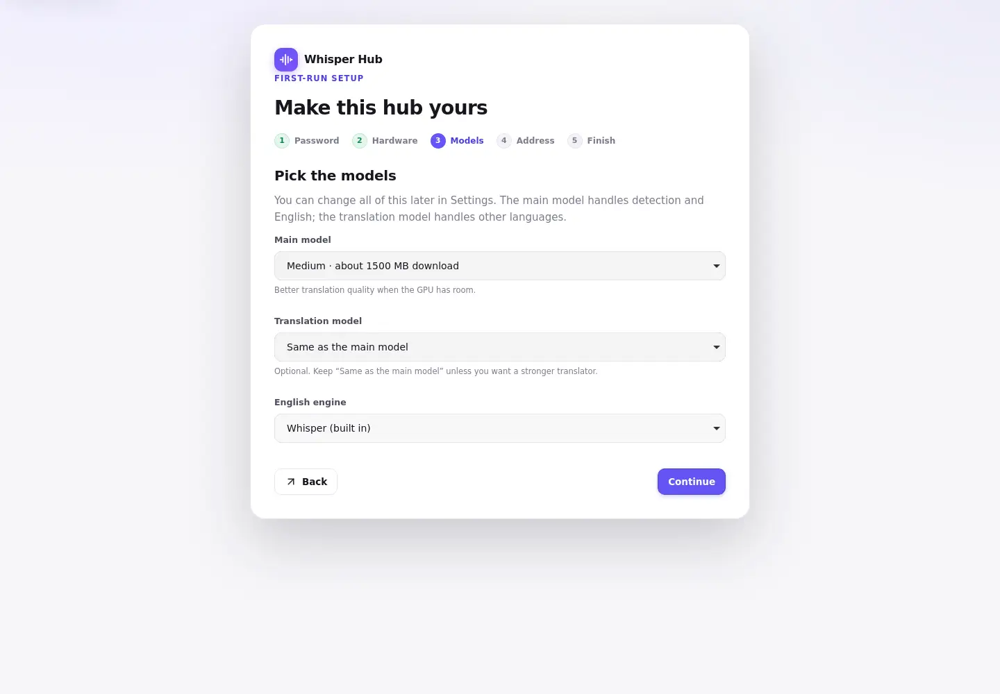
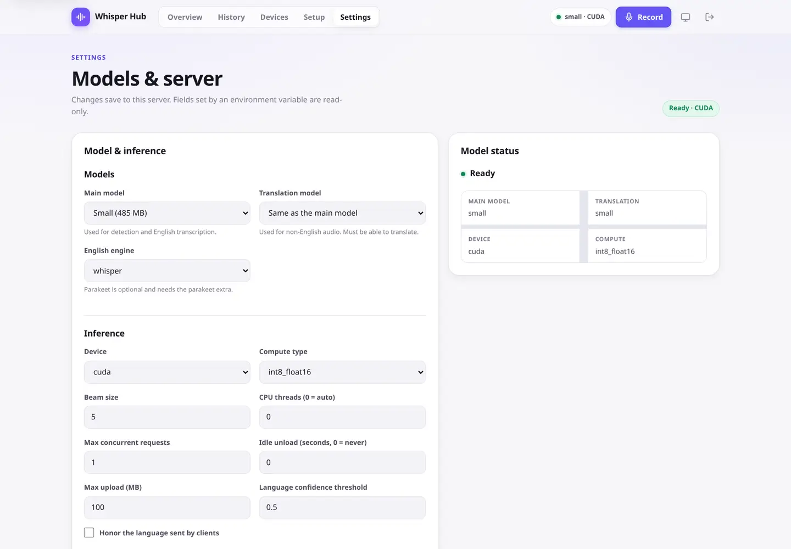
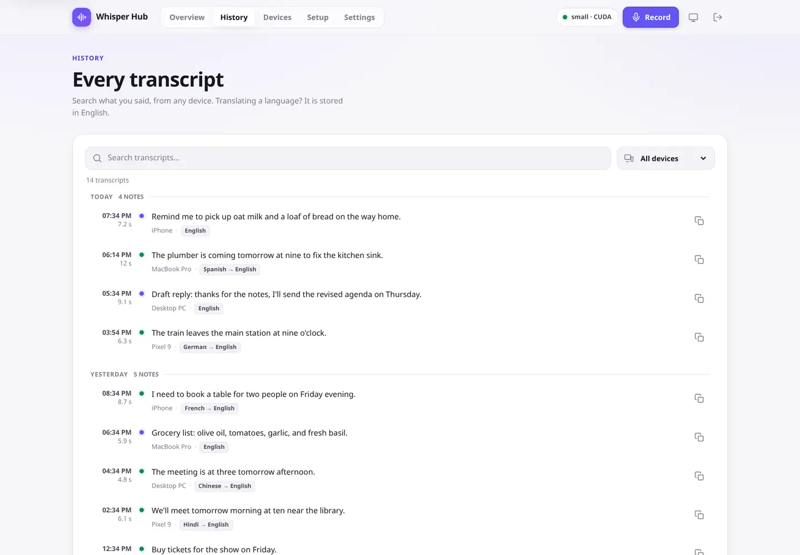
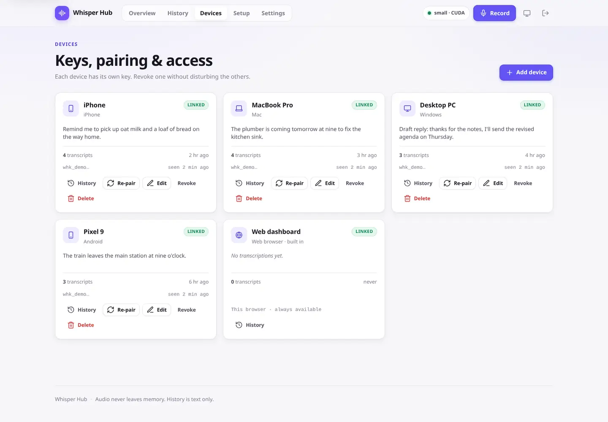

# Whisper Hub

One self-hosted Whisper server for all your devices. Point any
OpenAI-compatible dictation app at it, pair each device with its own API key,
and read every transcript in one shared, searchable history.

**Why:** phones, computers and keyboards each have their own transcription
service, their own history and their own API key. Whisper Hub gives them one
endpoint. Audio stays in memory; only English text is stored. No account, no
cloud, no audio files.



## Features

- OpenAI-compatible `POST /v1/audio/transcriptions` and
  `POST /v1/audio/translations`, plus `GET /v1/models`.
- Detects the spoken language. English is transcribed; every other language is
  translated to English.
- Per-device API keys, QR-code pairing, revoke/re-pair without touching other
  devices.
- Shared history with full-text search, device filters and per-entry detail.
- No stored audio. Uploads are parsed in memory and discarded.
- Web UI for first-run setup, model selection, hardware detection, live model
  status and all runtime settings.
- Background hot model swap: the old engine keeps serving while a new model
  downloads and loads, then the swap is atomic.
- Optional [Parakeet Ultra](#optional-parakeet-ultra) English engine for faster
  English dictation (proprietary runtime, telemetry disclosed below).

<table>
<tr>
<td></td>
<td></td>
</tr>
<tr>
<td></td>
<td></td>
</tr>
</table>

## Quick start

### Prebuilt image (no clone)

```bash
# CPU
docker run -d --name whisper-hub -p 8765:8765 -v whisper-hub-data:/data \
  -v whisper-hub-models:/home/app/.cache/huggingface \
  --tmpfs /tmp --restart unless-stopped ghcr.io/mekanismvibe/whisper-hub:latest
# NVIDIA GPU (needs the NVIDIA Container Toolkit)
docker run -d --name whisper-hub --gpus all -p 8765:8765 -v whisper-hub-data:/data \
  -v whisper-hub-models:/home/app/.cache/huggingface \
  --tmpfs /tmp --restart unless-stopped ghcr.io/mekanismvibe/whisper-hub:cuda

docker exec whisper-hub cat /data/setup_token   # then open http://<server>:8765/setup?token=<token>
```

The prebuilt images are `linux/amd64`. On ARM64, use the compose build below.
The second volume keeps downloaded models across container upgrades.

### Docker (CPU)

```bash
git clone https://github.com/mekanismvibe/whisper-hub.git
cd whisper-hub
docker compose up -d --build
docker compose logs -f whisper-hub
```

Open the `/setup?token=…` URL printed in the logs. The token is also in the
data volume; print it with:

```bash
docker compose exec whisper-hub cat /data/setup_token
```

The log URL contains the container hostname. From the Docker host, replace it
with `http://localhost:8765` and keep the `?token=…` part. To publish a different
host port, set `WHUB_HTTP_PORT` (e.g. `WHUB_HTTP_PORT=9000 docker compose up -d`).

### Docker (NVIDIA GPU)

Install the NVIDIA Container Toolkit, then:

```bash
docker compose -f compose.yaml -f compose.gpu.yaml up -d --build
```

The GPU image installs the CUDA wheels and requests one NVIDIA device. Choose
`cuda` in the wizard or later in Settings.

### uv

```bash
git clone https://github.com/mekanismvibe/whisper-hub.git
cd whisper-hub
uv sync                 # CPU
# uv sync --extra cuda  # NVIDIA wheels; the hub preloads cuBLAS/cuDNN itself
# Without the cuda extra, a GPU host falls back to the CPU automatically.
uv run whisper-hub
```

Data lives in `./data` by default. `--host` and `--port` override
`WHUB_HOST`/`WHUB_PORT`.

## First-run wizard

On a fresh instance the server has no admin password, so it prints:

```
First-run setup is required. Open http://<host>:8765/setup?token=…
```

The same one-time token is written to `data/setup_token`. The wizard then:

1. Sets the dashboard password (scrypt-hashed, at least 8 characters).
2. Shows detected hardware: CUDA GPU and VRAM (when available), CPU cores and
   RAM, and recommends a model.
3. Lets you pick the main model, translation model and English engine.
4. Asks for the public URL (prefilled from the request) and an optional HTTPS
   URL used behind a reverse proxy.
5. Signs you in and starts the model download/load in the background.

Until the wizard finishes, admin APIs answer `409 setup_required`. A legacy
`data/admin_password` file is migrated into the database automatically and
keeps working; you can delete it afterwards.

## Pairing a device

1. Open **Devices → Add device**, name it and choose its kind.
2. Scan the QR code, or open the pairing link on the device.
3. Follow the generated steps. The device key is shown once; send it as
   `Authorization: Bearer whk_…` (or `X-API-Key`).

Each device can be revoked, re-paired or deleted independently. Deleting a
device keeps its history as "Deleted device" unless you also tick the history
checkbox.

## Client guides

### iPhone / iPad — Apple Shortcuts

1. Open **Shortcuts** and create a shortcut, e.g. “Dictate to Whisper Hub”.
2. Add **Record Audio**. Allow microphone access on first run.
3. Add **Get Contents of URL**:
   - URL: `https://your-hub.example.com/v1/audio/transcriptions`
   - Method: **POST**, Request Body: **Form**
   - Field `file` = **Recorded Audio** (type File)
   - Field `model` = `whisper-1`
   - Field `response_format` = `text`
   - Header `Authorization` = `Bearer whk_…`
4. Add **Get Text from Input** → **Copy to Clipboard** → **Show Notification**.

The server returns plain text to Shortcuts by default, so the notification and
clipboard contain only the transcript. Plain HTTP on a private LAN works; allow
the local-network permission prompt on first use.

### Android — Dictate keyboard

Install **Dictate**, enable its keyboard in Android's input settings, and add an
OpenAI-compatible provider:

- Base URL: `http://your-hub.lan:8765/v1/` (keep the trailing `/v1/`)
- API key: the device's `whk_…` key
- Model: `whisper-1`
- Language: auto-detect

Text is inserted at the cursor.

### Desktop

- **OpenWhispr** (macOS/Windows/Linux): Settings → Providers → Custom. Base URL
  `http://your-hub.lan:8765/v1/`, model `whisper-1`, device key. It pastes the
  result at the cursor.
- **VoiceInk** (macOS): custom OpenAI-compatible model with the full endpoint
  `…/v1/audio/transcriptions`. Its connection test may reject plain HTTP on a
  LAN address; use your HTTPS URL if you have one.
- **Whispering**: add a custom OpenAI connection with the base URL and key. It
  copies text rather than pasting.

## Choosing a model

Use the wizard's recommendation as a starting point:

| Hardware | Suggested main model |
| --- | --- |
| CUDA GPU with 6 GB+ free VRAM | `medium` (or `large-v3` when translation quality matters most) |
| Smaller CUDA GPU | `small` |
| CPU only | `base`, or `small` with 8+ cores and enough RAM |

`large-v3-turbo` and the distil models are fast but **cannot translate**.
Choose a full model (for example `large-v3`) as the translation model if you use
one of them.

Installed models appear in Settings with live status: downloading, loading,
ready or error. A failed load keeps the previous engine running.

## HTTPS behind a reverse proxy

Browser recording needs a secure origin. Terminate TLS with Caddy and proxy to
the hub:

```caddyfile
whisper.example.com {
    reverse_proxy 127.0.0.1:8765
}
```

Set the **HTTPS URL** in Settings to `https://whisper.example.com`; pairing
links and client guides will prefer it. The hub itself binds to
`0.0.0.0:8765` and does not need TLS certificates.

## Environment variables

Runtime settings are normally managed in the web UI. An environment variable
takes precedence over the database and is shown read-only in the UI. Host,
port and data directory are environment/CLI only.

| Variable | Default | Purpose |
| --- | --- | --- |
| `WHUB_HOST` | `0.0.0.0` | Listen address (env/CLI only) |
| `WHUB_PORT` | `8765` | Listen port (env/CLI only) |
| `WHUB_DATA_DIR` | `./data` | SQLite, token and secret files (env/CLI only) |
| `WHUB_ADMIN_PASSWORD` | — | Initial dashboard password; setting it skips the wizard |
| `WHUB_MODEL` | `small` | Main Whisper model |
| `WHUB_TRANSLATE_MODEL` | main model | Model used for non-English audio |
| `WHUB_ENGLISH_ENGINE` | `whisper` | `whisper` or `parakeet` |
| `WHUB_PARAKEET_MODEL` | `moondream/parakeet-ultra` | Parakeet model id |
| `WHUB_DEVICE` | `auto` | `auto`, `cpu` or `cuda` |
| `WHUB_COMPUTE_TYPE` | `auto` | e.g. `int8`, `int8_float16`, `float16` |
| `WHUB_CPU_THREADS` | `0` | 0 = library default |
| `WHUB_BEAM_SIZE` | `5` | Decoding beam size |
| `WHUB_TRANSLATE_BEAM_SIZE` | `5` | Decoding beam size for translations |
| `WHUB_MAX_CONCURRENCY` | `1` | Concurrent inference requests |
| `WHUB_MODEL_IDLE_UNLOAD_SECONDS` | `0` | Unload after idle; 0 = never |
| `WHUB_MAX_UPLOAD_MB` | `100` | Upload limit |
| `WHUB_LANG_CONFIDENCE` | `0.5` | Threshold for re-decoding ambiguous clips as English |
| `WHUB_HONOR_CLIENT_LANGUAGE` | `false` | Use the client's `language` hint |
| `WHUB_PUBLIC_URL` | request URL | Base URL used in pairing links |
| `WHUB_HTTPS_URL` | — | Recommended HTTPS URL for clients |
| `WHUB_PRELOAD` | `true` | Load models at startup |

## Privacy

- Audio is decoded in memory and never written to disk. The container mounts
  `/tmp` as tmpfs as extra protection.
- Only transcript text and basic metadata (device, language, duration) are
  stored, in a local SQLite file with mode 0600.
- Logs never include transcript text.
- Settings → Data can export all history as JSON/CSV or delete it entirely.
- No cloud account or external service is used unless you enable Parakeet.

## Optional Parakeet Ultra

`uv sync --extra parakeet` installs Moondream's Photon runtime together with the
CUDA wheels Whisper needs. For Docker, build with `--build-arg EXTRAS=parakeet`.
When the English engine is set to `parakeet`:

- English audio is transcribed by Parakeet Ultra; other languages still use
  Whisper.
- The runtime is **proprietary software** under the M87 Labs licence, not an
  open-source component of this project.
- It sends **usage telemetry** (hostname, GPU information, request counts) to
  `api.moondream.ai`. It never sends audio or transcript text.
- If it fails, the request falls back to Whisper.

If either of those is unacceptable, keep the default `whisper` engine.

## API

```bash
curl -sS http://localhost:8765/v1/audio/transcriptions \
  -H "Authorization: Bearer whk_your_device_key" \
  -F file=@recording.m4a \
  -F model=whisper-1 \
  -F response_format=text
```

`response_format`: `json` (default), `text`, `verbose_json`, `srt`, `vtt`.
`GET /healthz` is unauthenticated and reports the active model and load state.
Settings → Setup shows copyable curl and OpenAI SDK examples.

## Development

```bash
uv sync
uv run pytest -q -m "not model"   # unit/API tests
uv run pytest -q -m model         # downloads the tiny model and round-trips audio
uv run whisper-hub                # http://127.0.0.1:8765
```

`paseo.json` contains optional dev-run and check commands. The architecture and
data model are described in [docs/ARCHITECTURE.md](docs/ARCHITECTURE.md).

## License

MIT — see [LICENSE](LICENSE). Copyright © 2026 mekanismvibe.
